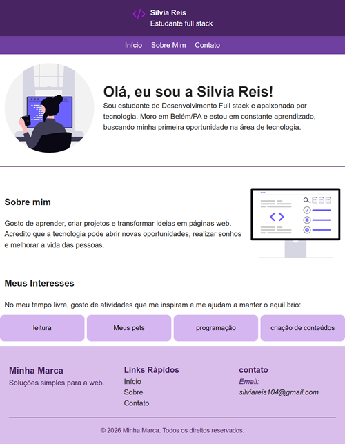

# Perfil pessoal — Silvia Reis

Página de apresentação pessoal desenvolvida durante o curso de Desenvolvimento Full Stack do SENAC. O projeto apresenta informações sobre a autora, seus interesses e formas de contato.

## Preview



## Tecnologias utilizadas


## Tags HTML utilizadas

- `<html>`, `<head>`, `<meta>`, `<title>` e `<link>`: estrutura e configurações do documento.
- `<body>`, `<header>`, `<main>`, `<section>` e `<footer>`: organização semântica da página.
- `<nav>`, `<ul>`, `<li>` e `<a>`: menus e links de navegação.
- `<div>`: agrupamento dos elementos.
- `<h1>`, `<h2>`, `<h3>`, `<h4>`, `<p>` e `<small>`: títulos e textos.
- ``: exibição das ilustrações.
- `<hr>`: divisores visuais.
- `<address>`: informações de contato.

## Recursos CSS utilizados

- Reset de margem e espaçamento.
- Variáveis CSS para a paleta de cores.
- Flexbox para alinhamento e distribuição dos elementos.
- Cabeçalho e menu fixos com `position: fixed`.
- Layout responsivo para telas de até 600px.
- Navegação suave com `scroll-behavior`.
- Estados de interação com `:hover`.
- Limitação de largura com `max-width`.
- Bordas, espaçamentos, cores e cantos arredondados.

## Estrutura do projeto

```text
perfil-senac/
├── imagens/
│   ├── code-review.svg
│   ├── code-xml.svg
│   ├── programmer.svg
│   ├── screencapture.png
│   └── typing-code.svg
├── index.html
├── style.css
└── README.md
```

## Como visualizar

1. Baixe ou clone este repositório.
2. Abra o arquivo `index.html` no navegador.

## Autora

Desenvolvido por **Silvia Reis**.
